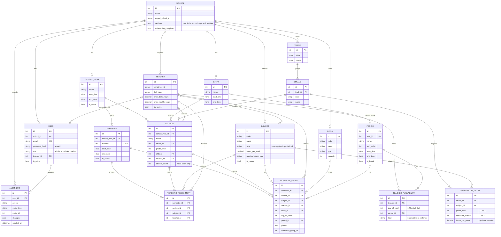

# SHS Class Scheduling and Teacher Loading System

A multi-school web app for building class schedules and teacher loads in
Philippine Senior High Schools (Grades 11-12), with automated conflict
detection.

**Status: Phase 1A complete.** Schools can register, finish a setup wizard,
and manage strands, subjects, sections, teachers and rooms (by hand or by
CSV/Excel import). Timetabling, conflict detection and the auto-scheduler
come in Phases 1B and 2.

| Layer | Technology |
|---|---|
| Frontend | Next.js 16 (React 19, TypeScript), Tailwind CSS 4 |
| Backend | Python 3.12, FastAPI, SQLAlchemy 2 |
| Database | PostgreSQL 16, Alembic migrations |
| Auth | JWT, argon2 password hashing, three roles |
| Tests | pytest, Vitest, Playwright |

## Project structure

```
shs-scheduler/
  scripts/            PowerShell helpers (env check, setup, run, test)
  backend/
    app/
      main.py         FastAPI app
      models.py       Database schema (SQLAlchemy)
      schemas.py      Request/response validation
      routers/        auth, school (onboarding), crud, imports, templates
      data/           shs_template.json - editable DepEd seed template
      seed.py         Fictional demo data
    alembic/          Database migrations
    tests/            pytest suite + e2e test server
  frontend/
    src/app/          Pages (login, register, onboarding, data pages)
    src/components/   Shared UI (CRUD page, import dialog, availability grid)
    src/lib/          API client, auth, bell-schedule helpers
    e2e/              Playwright browser tests
  docker-compose.yml  Optional PostgreSQL container (untested, see below)
```

## Where everything lives (drive D only)

| What | Location |
|---|---|
| Project | `D:\Projects\shs-scheduler` |
| Python 3.12 | `D:\Tools\Python312` |
| Node.js | `D:\Tools\nodejs` |
| PostgreSQL 16 | `D:\Tools\PostgreSQL` |
| Git | `D:\Tools\Git` |
| PostgreSQL data | `D:\Databases\pgdata` (logs in `D:\Databases\pglog`) |
| pip / npm / Playwright caches | `D:\Cache\pip`, `D:\Cache\npm`, `D:\Cache\ms-playwright` |
| Global npm packages | `D:\Tools\npm-global` |
| Temp files | `D:\Temp` |
| Python packages | `backend\.venv` (never global) |

These are portable copies that sit beside whatever is installed on drive C.
Nothing on C was changed and the system PATH was not edited. Instead,
`scripts\env.ps1` puts the D: tools first **for the current terminal only**.

> **Every new terminal:** run `. .\scripts\env.ps1` first (note the leading
> dot), or use the `scripts\*.ps1` helpers, which do it for you.

`D:\Data` was not used for PostgreSQL because it already holds a MySQL data
directory on this machine.

### Reinstalling the tools on another machine

Download and unzip - no installers needed:

| Tool | Download | Unzip to |
|---|---|---|
| Python 3.12.10 | `https://api.nuget.org/v3-flatcontainer/python/3.12.10/python.3.12.10.nupkg` (a zip; use its `tools` folder) | `D:\Tools\Python312`, then run `python -m ensurepip` |
| Node.js | `node-v<version>-win-x64.zip` from nodejs.org | `D:\Tools\nodejs` |
| PostgreSQL 16 | `postgresql-16.<x>-1-windows-x64-binaries.zip` from EnterpriseDB (use its `pgsql` folder) | `D:\Tools\PostgreSQL` |
| Git | `MinGit-<version>-64-bit.zip` from git-for-windows releases | `D:\Tools\Git` |

Then create the database cluster once:

```powershell
. .\scripts\env.ps1
initdb -D D:\Databases\pgdata -U postgres -W -A scram-sha-256 -E UTF8 --locale=C
```

Docker Desktop is optional and not required. If you install it, keep it on D:

```
"Docker Desktop Installer.exe" install --installation-dir=D:\Tools\Docker --wsl-default-data-root=D:\Data\DockerWSL
```

## Setup

```powershell
cd D:\Projects\shs-scheduler
copy .env.example .env        # then edit: database password and a long random JWT_SECRET
powershell -ExecutionPolicy Bypass -File scripts\setup.ps1
```

`setup.ps1` runs the environment check, creates the Python venv, installs
pinned packages, starts PostgreSQL, creates the database, applies migrations
and installs the frontend packages.

Optional demo data (fictional names only):

```powershell
. .\scripts\env.ps1
cd backend
.\.venv\Scripts\python.exe -m app.seed
```

| Demo account | Email | Password |
|---|---|---|
| Admin | `admin@demo.example` | `DemoPass#2026` |
| Scheduler | `scheduler@demo.example` | `DemoPass#2026` |
| Teacher (read-only) | `teacher@demo.example` | `DemoPass#2026` |

## Running

Two terminals:

```powershell
powershell -ExecutionPolicy Bypass -File scripts\run-backend.ps1    # API  -> http://localhost:8000
powershell -ExecutionPolicy Bypass -File scripts\run-frontend.ps1   # App  -> http://localhost:3000
```

Interactive API docs: http://localhost:8000/docs

PostgreSQL runs as a normal process, not a Windows service, so it does not
start with Windows. `run-backend.ps1` starts it; `scripts\pg-stop.ps1` stops it.

## Tests

```powershell
powershell -ExecutionPolicy Bypass -File scripts\test.ps1          # pytest + typecheck + lint + Vitest
powershell -ExecutionPolicy Bypass -File scripts\test.ps1 -E2E     # also the Playwright browser tests
```

- Backend tests use a separate database, `shs_scheduler_test`.
- Browser tests start their own API (port 8001, database `shs_scheduler_e2e`,
  wiped each run) and their own frontend build (port 3001), so they never
  touch development data.

Phase 1A tests cover authentication, the three roles, isolation between
schools, onboarding rules, CRUD validation, CSV/Excel import, the seed
template, the audit log, and a check that no student personal data exists in
the schema. Tests for the nine scheduling hard constraints arrive with the
conflict engine in Phase 1B.

## User guide

### Roles

| Role | Can do |
|---|---|
| Admin | Everything, including school setup, user accounts and the audit log |
| Scheduler | Add and edit strands, subjects, sections, teachers, rooms; import files |
| Teacher | View only |

### 1. Register your school

Open the app and choose **Register your school**. This creates your school's
private workspace and your administrator account. Each school's data is
completely separate from every other school's.

### 2. Finish the setup wizard

1. **School** - name, DepEd School ID, address, division, region, optional
   logo, and the default teacher load limits (hours per day and per week).
2. **School year** - first and last day of classes and the dates of the two
   semesters.
3. **Shifts** - one whole-day shift, or morning and afternoon shifts for
   schools that share rooms.
4. **Bell schedule** - for each shift, type a period length and count and
   press **Generate**, then adjust any row. Tick **Break** for recess or lunch.
5. **Strands** - tick the strands you offer to load starter subjects and a
   sample curriculum, or skip and enter your own.

You can reopen the wizard later from **School setup**.

### 3. Enter your data

Use the menu on the left (or the **Menu** button on a phone):

- **Tracks & strands**, **Subjects**, **Rooms** - add, edit, delete, search.
- **Teachers** - employee ID, name, load limits (blank = school default),
  the subjects each teacher is qualified for, and a grid where you click a
  time slot to mark it *unavailable* (never scheduled) or *preferred*.
- **Sections** - strand, grade level, shift, adviser and number of students.
- **User accounts** (admin) - create scheduler and teacher logins.

### 4. Import from CSV or Excel

On Strands, Subjects, Rooms, Teachers and Sections, choose
**Import CSV / Excel**:

1. **Download template** to get the right column headings.
2. Fill it in and choose the file.
3. **Check file** shows what would happen without saving anything.
4. **Import** saves the good rows and lists any problem rows by row number.

Rows are matched by code (employee ID for teachers, name for sections):
matching rows are updated, new ones are added. Import subjects before
teachers, and strands and teachers before sections, because later files
refer to earlier ones by code. For teachers, list qualified subject codes
separated by semicolons, for example `CORE-GENMATH;CORE-STAT`.

## Database schema



Every table except `SCHOOL` also carries `school_id`. `TEACHING_ASSIGNMENT`
and `SCHEDULE_ENTRY` exist in the schema now and are used from Phase 1B.

## Data privacy (RA 10173)

- **Minimum data.** Teachers: name, employee ID, load limits, qualifications
  and availability only. Students: no personal data at all - sections store
  a head count. A test fails if a student column is ever added.
- **Access control.** Three roles, enforced on the server for every request.
  A deactivated account loses access immediately.
- **Tenant isolation.** Every query is filtered by the signed-in user's
  school, and references to another school's records are rejected.
- **Passwords.** Hashed with argon2id; never logged or returned.
- **Audit log.** Every create, update, delete and import is recorded with
  who and when (admin-only view at `GET /api/audit-logs`).

## Assumptions made

1. Grade levels are fixed at 11 and 12 (a validated number, not a table).
2. School days are Monday-Friday, with Saturday as an option per school.
3. Each shift has its own bell schedule; breaks are periods flagged as breaks.
4. Load limits are in **hours**; defaults are 6 per day and 30 per week,
   editable per school and per teacher.
5. A teacher's availability is per day-and-period: unavailable (hard) or
   preferred (soft).
6. One school year and one semester are "active" at a time; new sections go
   into the active school year.
7. Anyone can register a new school. Approval and billing come in Phase 3.
8. Email is the login name. There is no email verification or password
   reset by email yet (an admin can reset a user's password).
9. The session token is kept in the browser's local storage and lasts 8 hours.
10. Deleting a track, strand, shift or subject that is in use is blocked
    rather than cascading.
11. PostgreSQL is run by a script rather than as a Windows service.

## DepEd rules you must verify yourself

These are configurable data in the app; the shipped values are placeholders.

1. **Teacher load limits.** The 6 hours/day default follows the usual
   reading of RA 4670 (Magna Carta for Public School Teachers) Sec. 13.
   Confirm the current daily and weekly limits, and how advisory, ancillary
   and overload hours count, against the latest DepEd Orders.
2. **Curriculum.** `backend/app/data/shs_template.json` lists tracks,
   strands, subjects, hours per week and grade/semester placement based on
   the original K to 12 SHS curriculum guides. DepEd has been revising the
   SHS curriculum (the "Strengthened SHS" program), which changes tracks
   and subject offerings. Check which curriculum applies to your school and
   school year, and edit the template or the records accordingly.
3. **Hours per subject.** The template assumes 80 hours per semester for
   most subjects (about 4 per week), 160 for TVL specializations, and 20
   for PE and Health. Verify against the official curriculum guides.
4. **TVL specializations.** Only a few sample specializations per strand
   are included. Replace them with the ones your school is permitted to offer.
5. **Work Immersion** hours and delivery mode vary by strand and school.
6. **Class size** limits and room standards are not enforced beyond room
   capacity; check the applicable DepEd guidelines.
7. **School calendar.** Demo dates are illustrative. Use the official
   school calendar for your school year.
8. **Data privacy compliance.** Technical safeguards are in place, but
   registration with the National Privacy Commission, a privacy notice, and
   a data sharing or processing agreement are your responsibility.

## Known limits in Phase 1A

- No screen yet for editing curriculum rows or the audit log (both are
  available through the API).
- Editing an existing school year's dates is API-only.
- No login rate limiting yet; add it before any public deployment.
- `docker-compose.yml` has not been run on this machine.
